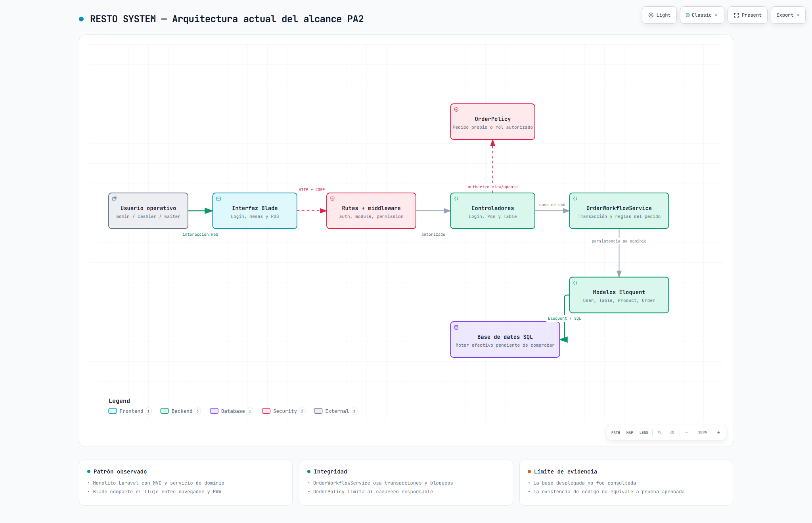
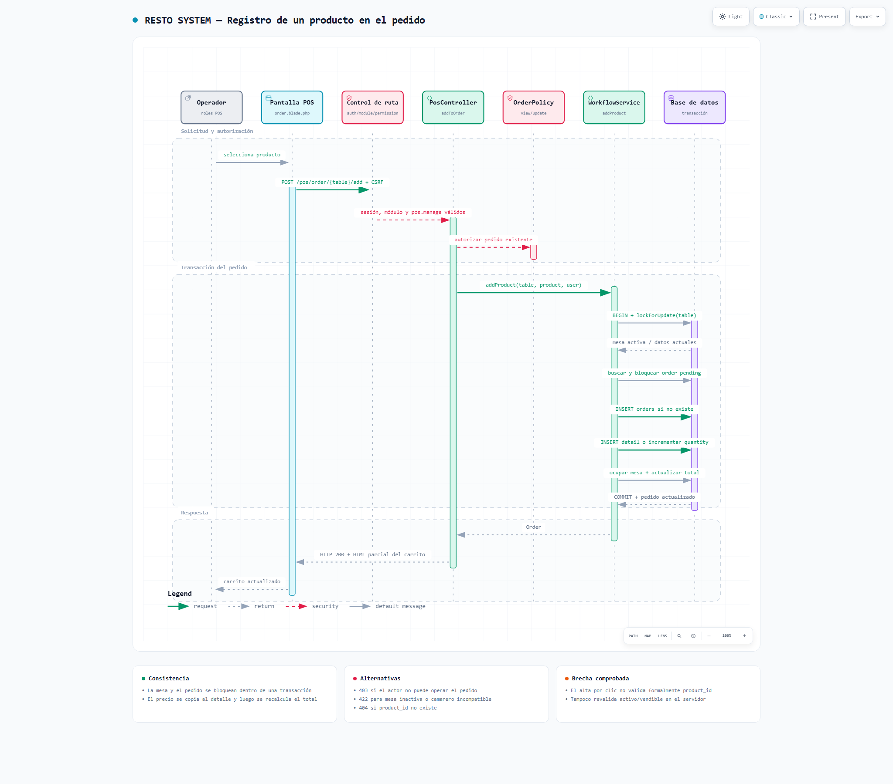
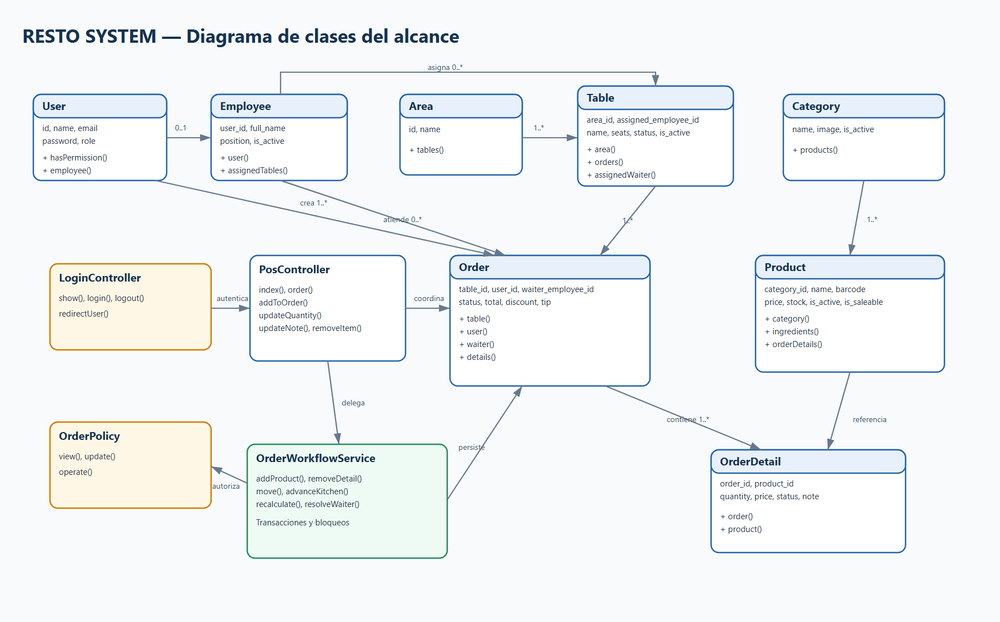
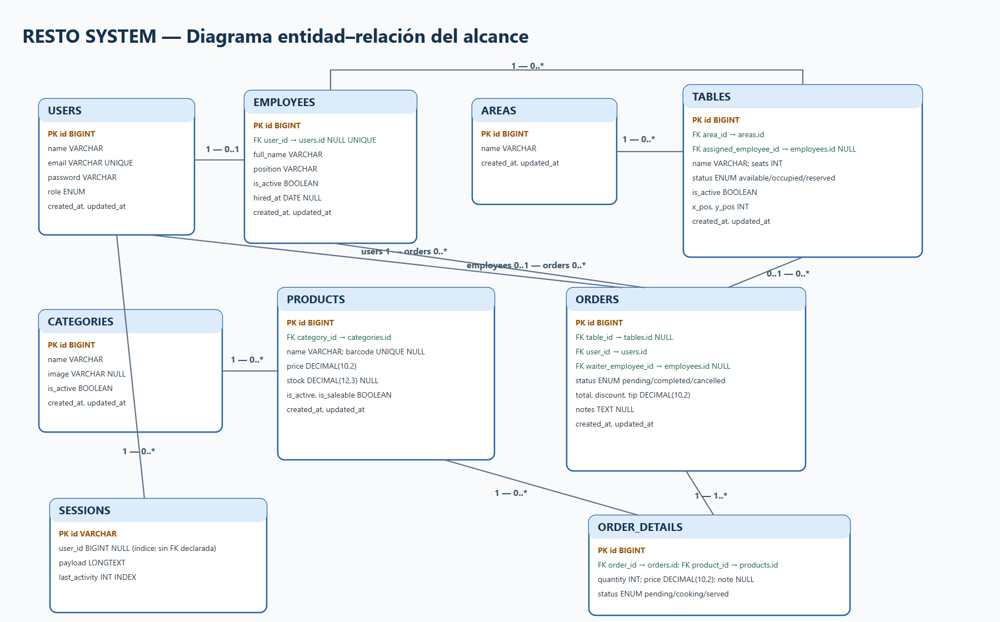
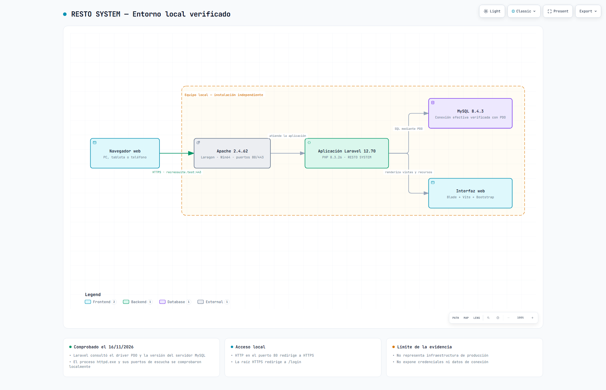

# RESTO SYSTEM — evidencia académica PA2

Este repositorio contiene una entrega académica limitada del curso Construcción de Software. Documenta evidencia comprobada de un sistema existente sin publicar el proyecto fuente completo ni convertir esta entrega en una aplicación ejecutable.

## Alcance incluido

- Login, sesiones, roles y permisos.
- Mesas y asignación de camareros (mozos).
- Registro de pedidos y selección de productos del menú.
- Dependencias directas necesarias para explicar esos flujos.

## Contenido

- [Alcance y trazabilidad](evidencias/ALCANCE_Y_TRAZABILIDAD.md): matriz resumida del material incluido.
- [Entorno verificado](evidencias/ENTORNO_VERIFICADO.md): motor de base de datos, servidor, URL y puerto.
- [Fragmentos de código](evidencias/FRAGMENTOS_DE_CODIGO.md): tres extractos breves y contextualizados.
- [Diagramas](docs/diagramas): arquitectura, clases, base de datos, secuencia y despliegue.

## Diagramas principales

| Arquitectura del alcance | Secuencia del pedido |
|---|---|
|  |  |

| Clases | Base de datos | Despliegue local |
|---|---|---|
|  |  |  |

## Límites de publicación

Esta entrega no incluye el historial Git del producto, código fuente completo, `.env`, credenciales, base de datos, archivos de usuarios, respaldos, logs, dependencias instaladas, configuraciones de clientes ni módulos ajenos al PA2. Los fragmentos se ofrecen exclusivamente como evidencia técnica del alcance académico.

El repositorio no es instalable ni ejecutable. Que una función tenga código o pruebas escritas no demuestra por sí solo que haya sido ejecutada satisfactoriamente; el informe diferencia entre implementado, parcial, pendiente de comprobar y propuesta.

## Identificación de la evidencia

- Sistema académico: **RESTO SYSTEM**.
- Revisión técnica: 16 de noviembre de 2026, zona horaria America/Lima.
- Rama del código privado inspeccionado: `develop`.
- Revisión del código privado inspeccionado: `e53e6520ec87fd8a74fc52ff5227543e922341d4`.
- Este repositorio académico posee un historial independiente y no es un fork del producto.

