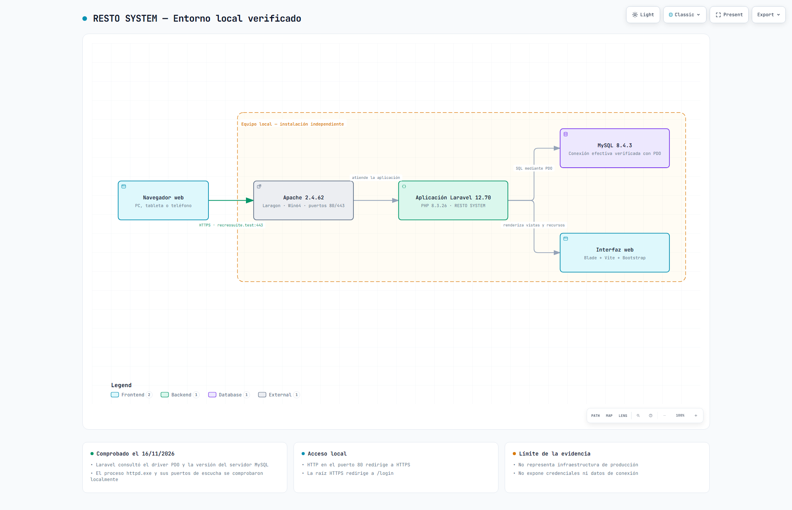

# Entorno local verificado

Comprobación realizada el 16 de noviembre de 2026 sin modificar archivos ni datos y sin mostrar credenciales.

| Dato | Resultado | Forma de verificación |
|---|---|---|
| Motor usado realmente por Laravel | MySQL 8.4.3 | Se inició Laravel y se consultaron el driver PDO y la versión del servidor desde la conexión efectiva. No se tomó el valor predeterminado de `config/database.php`. |
| Servidor web | Apache 2.4.62 Win64 | Se comprobó la versión local y el proceso `httpd.exe` de Laragon que mantiene los puertos web en escucha. |
| URL local efectiva | `https://recreosuite.test` | La solicitud local HTTPS respondió y redirigió a `/login`. |
| Puerto web | 443 | Se comprobó la escucha y respuesta HTTPS. El puerto 80 también escucha, pero redirige a HTTPS. |

La suite de pruebas configura SQLite en memoria; esa base pertenece al entorno de pruebas y no es el motor efectivo de la instalación revisada.

